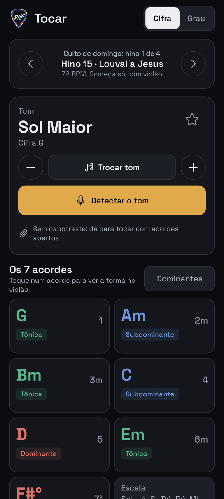
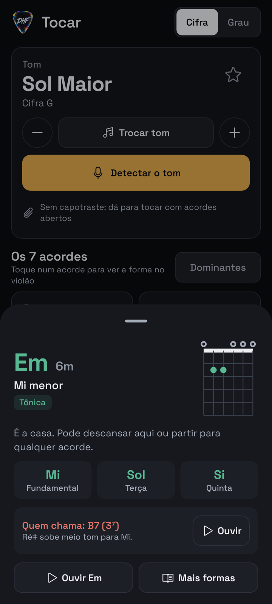
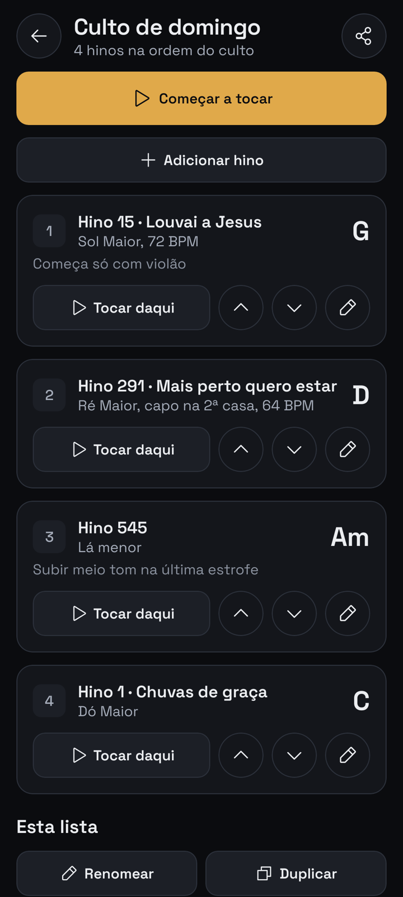
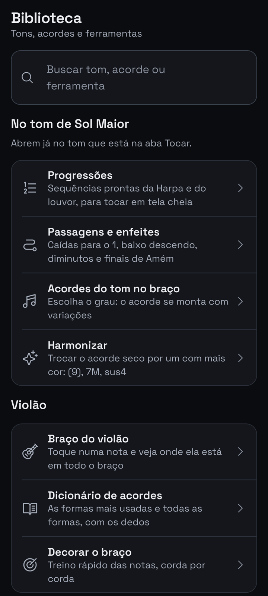
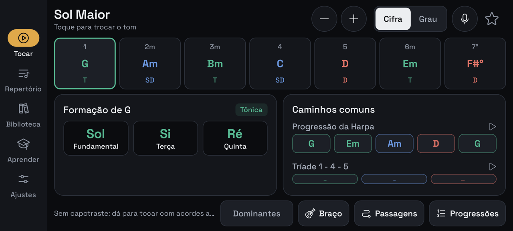

# Digital Harmonic Field

Aplicativo Android para consulta rápida de **campos harmônicos**, pensado para
músicos que tocam ao vivo — em cultos, ensaios e eventos. Escolha um tom e veja,
na hora, os sete graus, a função de cada acorde e as notas que o formam. Tudo
offline, com tema escuro (para palco) e claro (com as cores da abertura).

Desenvolvido em **Kotlin** com **Jetpack Compose** e **Material 3**.
Criado por **José Renato** (**JR TECH OFC**): músico, fotógrafo e programador.

> 📄 **[O que é o app](docs/SOBRE.md)** · 🎨 **[Guia de design](docs/DESIGN.md)**

---

## O que o app faz

Ao abrir: o **vídeo de abertura** (a palheta DHF, com som) e, em seguida, a
tela da **JR TECH OFC** por ~3 s, com os direitos do autor e um botão "Sobre o
app". Por padrão a abertura toca só na primeira vez do dia (no culto o app é
aberto muitas vezes); dá para mudar ou desligar em Ajustes > Abertura.

Tudo gira em volta do **tom do momento**: o tom em que você está tocando agora.
A aba Tocar mostra o campo dele, e todas as ferramentas (progressões,
passagens, braço, dicionário, capotraste, metrônomo) já abrem nesse tom. Quem
muda o tom é você (Trocar tom, -/+ meio tom), o **Detectar tom** ou o hino do
repertório em andamento. Se o app fechar no meio do culto, ele volta no mesmo
ponto.

O app é organizado em cinco abas, pelo que o músico faz no culto:

| Aba | Para quê | O que tem |
|---|---|---|
| **Tocar** | Na hora de tocar | O **hino da vez** (anterior/próximo, o tom troca junto), o tom em destaque (trocar, **transpor**, voltar ao original), **Detectar o tom**, o capotraste sugerido, os **7 acordes** (um toque mostra a forma no violão, as notas e quem chama o acorde), as dominantes e os atalhos no tom |
| **Pregação** | Fundo da Palavra | **Sequências de fundo** para pregação, oração, apelo, Santa Ceia e volta ao hino (52 no total), com a sensação de cada uma, como tocar, o som e a **tela cheia que passa sozinha**; e os **acordes bonitos** explicados |
| **Repertório** | Organizar o culto | **Várias listas** ("Culto 08/11", "Santa ceia"), cada hino com número, tom, capotraste, **BPM** e observação; Começar, Tocar daqui, duplicar e enviar no WhatsApp |
| **Biblioteca** | Consultar tudo | **Busca** (tom pelo nome ou cifra, acorde como "D7", ferramenta), as ferramentas no tom do momento, o violão, o **Aprender** (lições de 1 a 10 e treinos) e os 24 tons |
| **Ajustes** | Configurar | Tema (escuro, claro, do sistema), ícone do app, tamanho do texto, menos animação, abertura, notação, tela acesa, vibração, dados, Sobre e documentos legais |

As telas internas entram deslizando por cima da aba, com "Voltar", e a tela de
baixo continua do jeito que estava. Deitado (paisagem), as abas ficam numa
barra lateral e o Tocar mostra tudo sem rolagem. Segurando o ícone do app na
tela inicial aparecem atalhos para **Detectar tom**, **Pregação**,
**Repertório** e **Metrônomo**. Botões e seletores têm animações curtas de
toque e de troca (desligáveis em "Menos animação"). O visual segue o
[guia de design](docs/DESIGN.md): escuro, latão só na ação principal e cor só
para a função do acorde.

<p>
  
  
  
  
</p>
<p>
  
</p>

### Tocar (o campo harmônico do tom do momento)
A função central. Você vê:

- Os **sete graus** do campo, cada um com sua **função tonal** (Tônica,
  Subdominante ou Dominante) sinalizada por cor. Um toque abre a **folha do
  acorde**: forma no violão, notas (fundamental, terça e quinta), tendência,
  quem chama o acorde, botão para ouvir e "Mais formas" no dicionário.
- **Transposição** em tempo real (meio tom por toque), com "voltar ao original"
  e, seguindo o repertório, "Salvar o tom no hino" para o próximo culto.
- O **capotraste** sugerido para tocar com acordes abertos.
- **Caminhos comuns** já montados no tom (a Progressão da Harpa e o 1-4-5),
  que abrem em tela cheia.
- As **notas da escala** e a estrela de **favorito**.
- **Modo paisagem** compacto: todos os graus na tela, sem rolagem, para uso
  ao vivo.

### Pregação (fundo musical)
Sequências de acordes para tocar baixinho na hora da Palavra, separadas por
momento: **Pregação** (fundo discreto, como o vai e vem 1 - 4 e o baixo
parado), **Oração** (4 - 1, 4 - 4m - 1, pedal), **Apelo** (1 - 5 - 6m - 4,
4 - 5 - 3m - 6m, que crescem aos poucos), **Ceia e ministração** (7M, baixo
descendo) e **Voltar ao hino** (5sus4 - 5, cadências). São 35 no tom maior e
17 no menor, só com acordes simples ou cores leves, no tom do momento. Cada
uma diz a sensação e como tocar, tem o som, as formas no violão e a **tela
cheia** com **passar sozinho** (8, 6 ou 4 segundos por acorde). Em "Acordes
bonitos", a nona, o sus, a sétima maior, o 4/5, o baixo parado e outros são
comparados com o acorde simples. Guia completo em
[`docs/fundo-de-pregacao.md`](docs/fundo-de-pregacao.md).

### Biblioteca
A busca acha **tons** ("sol", "Am", "fá sustenido menor"), **acordes** ("D7",
"Bm7", "C7M": abre o dicionário) e **ferramentas** ("metrônomo", "capo"), sem
acento e sem internet. Abaixo, as ferramentas que abrem no tom do momento e
os 24 tons (um toque e o tom vai para o Tocar).

### Dominantes secundárias (o "5 de cada grau")
Uma chave na aba Tocar mostra, **em cima de cada acorde**, o acorde
maior com sétima que chama ele (em Dó: A7 → Dm, B7 → Em, C7 → F, D7 → G,
E7 → Am). Tocando num acorde, o app mostra a nota de fora do campo e para onde
ela anda (o Dó# do A7 sobe para Ré), onde a dominante entra no hino, o cuidado
com a melodia, um exemplo no tom e o som (dominante → alvo). Funciona nos 24
tons, no modo Grau e em paisagem. Guia completo em
[`docs/dominantes-secundarias.md`](docs/dominantes-secundarias.md).

### Modo Grau (para quem toca "por número")
Uma chave **Cifra | Grau** muda o app inteiro: em vez de "C, Am, F, G", os
acordes aparecem como **1, 6m, 4, 5** (com a cifra pequena embaixo) — no campo,
nas progressões, na tela cheia e no detector de tom. A escolha fica salva.

### Braço do violão (laboratório)
Um braço de violão "de verdade" na tela (casas na proporção real, 6ª corda à
esquerda, marcações 3‑5‑7‑9‑12), com quatro abas:

- **Notas:** todas as notas do braço; toque numa casa (ou escolha a nota) e
  aparecem **todas as posições** dela, corda por corda, com o atalho da oitava.
  Nomes em Dó‑Ré‑Mi ou C‑D‑E.
- **Acordes:** escolha o grau (ou qualquer nota) e o **tipo** — maior, m, (9),
  m(9), sus2, sus4, 6, m6, 6(9), 7M, 7M(9), 7, 7(9), 7sus4, m7, m7(9), m7(b5),
  °, °7. O acorde **se monta sozinho** no braço, com **variações** espalhadas
  (aberto, casa 3, casa 5…), cada nota marcada pelo papel (1, 3, 5, 7, 9…), e dá
  para **ouvir** cada forma. No modo "Onde estão 1, 3, 5" você liga/desliga
  cada papel e monta o acorde sozinho.
- **Harmonizar:** para cada grau, trocas que tiram o hino do acorde "seco" sem
  mudar a função (1(9), 1⁶⁽⁹⁾, 4⁷M, 5sus4 → 5, 2m⁷, 4m emprestado, 1/3, 4/5,
  5/7…), com desenho, explicação e áudio — e um **antes × depois** para ouvir a
  diferença.
- **Decorar:** o método passo a passo (ver `docs/braco-do-violao.md`) e dois
  jogos: **Que nota é?** e **Ache a nota**, por fases (6ª corda, 5ª, as duas,
  braço todo).

Abre pela Biblioteca, pelo atalho "Braço" da aba Tocar (já no tom do momento) ou por Aprender (Decorar o braço).

### Progressões
Sequências harmônicas já montadas no tom escolhido, organizadas por uso:
**Essenciais para hinos** (com destaque para a **Progressão da Harpa**,
I – vi – ii – V – I, e o 1‑4‑5), **Finais de frase** (cadência perfeita, do
"Amém", ii – V – I, meia cadência) e **Louvor e outras**. Os acordes ocupam a
largura da tela — nada de arrastar a linha para o lado — e cada progressão abre
em **tela cheia para tocar**: acordes gigantes, passo atual destacado, troca de
tom na hora (− / +) e tela sempre acesa.

### Aprender (na Biblioteca)
Um guia para o tocador iniciante da assembleia: o que é campo harmônico, as três
funções, a progressão da Harpa, **como tirar música de ouvido**, o sistema de
números (1‑4‑5) e o **círculo das quintas explicado com uso prático** — um mapa
interativo que mostra, para cada tom, sua subdominante, dominante e relativa
menor.

Módulos de **graus**:
- **Como pegar os graus** — passo a passo (achar o 1, a "escada" do tom, a
  sensação de cada grau, seguir o baixo, caminhos de hino) e **treino**: pelo
  ouvido (o app toca o 1 e depois um acorde — qual é o grau?), cifra → grau e
  grau → cifra, em três níveis (1·4·5 → +6m → +2m·3m).
- **Graus a fundo** — campo maior × menor (o 5 maior no tom menor), graus com
  sétima, dominantes secundárias (1⁷ → 4…), diminutos de passagem, baixo
  caminhando (5/7, 1/3), empréstimo (4m) e transposição — tudo calculado no tom
  escolhido.

### Dicionário de acordes
Escolha a nota e o tipo (19 tipos: maior, m, 7, 7M, m7, (9), sus4, 6(9),
m7(b5), °7…) e veja:

- **Mais usadas:** as 5 formas do sistema **CAGED** (as das revistinhas). Ex.:
  Sol aberto, forma de Mi (pestana na 3ª), forma de Ré (5ª casa), forma de Dó
  (7ª) e forma de Lá (pestana na 10ª).
- **Todas:** todas as formas tocáveis até a casa 15 (o Sol maior tem 61), com
  filtros *sem pestana*, *corda solta* e *baixo na 6ª / 5ª / 4ª corda*.
- A forma escolhida aparece **grande no braço**, com o **número do dedo** em
  cada casa (1 indicador … 4 mindinho) ou com as notas (1 · 3 · 5), e um
  **passo a passo** em texto: "Dedo 1 deitado na casa 3 (pestana)…".
- **Ouvir** cada forma. Abre pela Biblioteca (ou buscando "D7"), pela folha do acorde no Tocar, pela aba Acordes do braço do
  violão ("Todas as formas") e pelas passagens.

### Passagens e enfeites (as "graças")
O que o tocador experiente faz entre um acorde e outro do hino. Escolha o tom e
o **momento da música** — *voltar ao 1*, *descer o baixo*, *1 → 4*, *1 → 5*,
*1 → 6m*, *1 → 2m*, *4 → 5*, *subir*, *final (Amém)* — e veja as ideias, do
nível Básico ao Profissional: 2m – 5 – 1, cadência de hinário (1/5), 1 – 5/7 –
6m, diminutos de passagem (#1°, #4°), dominantes secundárias (2⁷, 3⁷, 6⁷), 4 –
4m – 1, b6 – b7 – 1, terça de Picardia no tom menor e outras. Cada ideia mostra
os acordes no tom (cifra ou grau, na cor da função), marca os que saem do campo
("fora"), explica o porquê, toca **o direto e a passagem** para comparar e
mostra o desenho de cada acorde no braço. Abre pela aba Tocar
(atalho "Passagens", no tom do momento) e pela Biblioteca.

### Repertório do culto
Várias listas de hinos, na ordem do culto: número da Harpa, nome, tom,
capotraste, **BPM** e observação ("subir meio tom no fim"). **Começar a tocar**
leva a lista para a aba Tocar: um hino de cada vez, com o tom trocando sozinho
e o metrônomo já no BPM do hino. Dá para duplicar a lista do domingo passado,
renomear e enviar no WhatsApp do grupo de louvor. Salvo só no aparelho.

### Na hora de tocar: detectar tom, metrônomo e capotraste
Utilitários para a hora de tocar, todos sem depender de internet:

- **Detectar tom** (o botão principal da aba Tocar). O tom escolhido vira o tom do momento. Ouve em **rodadas de
  5 segundos** e mostra os **3 tons mais prováveis**, com a chance de cada um e
  os acordes para começar.
  - **1ª rodada na hora:** com a tela aberta, os últimos 5 s ficam só na memória
    (nada é gravado nem enviado; ao sair, tudo é apagado).
  - **2ª e 3ª rodadas:** somam mais canto e mostram o palpite ao vivo. Para
    sozinho quando tem certeza; dá para **parar e usar** a qualquer momento ou
    pedir **mais 5 s** no mesmo hino. Vibra ao terminar.
  - **Modelo treinado:** uma rede neural pequena, treinada com milhares de
    trechos de hinos, analisa o que o músico percebe de ouvido — notas mais
    cantadas, fim de frase, sensível subindo para a tônica, baixo fazendo 5 → 1.
    Roda no aparelho, sem internet.
  - **Sensibilidade do microfone:** automático ou fader manual, com atalhos
    *Culto forte*, *Normal* e *Capela baixa* e um medidor com a faixa ideal.
  - **Foco na voz + canal do baixo**, filtro de ruído constante e do zumbido da
    rede elétrica. Sem evidência suficiente, **não sugere tom**.
  - Na bancada de testes (hinos que o modelo nunca viu, áudio simulado de
    culto), acerta ~**8,5 em 10** hinos simples no estilo da Harpa. Detalhes em
    [`docs/detector-de-tom.md`](docs/detector-de-tom.md).
- **Metrônomo** — som sintetizado, ajuste por slider ou passo, "marcar tempo"
  (tap tempo), escolha de compasso e indicador visual dos tempos.
- **Capotraste** — indica em que casa colocar o capo para tocar com acordes
  abertos (formatos CAGED) e soar no tom desejado.

### Versão DEV — treino real
Uma variante para **testar no culto e gerar material de treino** (`gradle
:app:assembleDev`). Instala ao lado do app normal e, a cada hino detectado,
salva o trecho de áudio e o que o detector pensou em cada rodada. Abaixo do
resultado você marca o **tom certo** (um toque no sugerido ou num seletor),
dá **estrelas** e **etiquetas**; tudo vai para uma única pasta (`sessoes.json`,
`log.jsonl`, áudios) que o app compacta e **compartilha em .zip**. Inclui um
painel com o acerto real nos seus hinos e um **treinador** que só troca o
modelo se melhorar. Guia completo em [`docs/treino-real.md`](docs/treino-real.md).
O app normal **não grava nada**.

---

## Design

A interface foi reconstruída em torno de três princípios:

- **Sobriedade**: fundo quase-preto, superfícies em camadas e um único acento
  (latão) usado apenas para ação e foco. Sem brilhos ou gradientes decorativos.
- **Cor com significado**: em vez de tons avulsos, cada acorde recebe a cor da
  sua função tonal (Tônica / Subdominante / Dominante) — o que também ensina
  teoria enquanto se usa.
- **Tipografia própria**: a família *Space Grotesk*, com dígitos marcantes,
  dá identidade e legibilidade às cifras.

---

## Ícone (escuro e claro, trocável)

O app tem **dois ícones**, e você escolhe em **Ajustes > Ícone do app**, sem
reinstalar: **Escuro**, **Claro** (o quadro final da abertura: palheta de vidro
sobre azul e bege) ou **Pelo tema** (segue o tema do app). A troca usa duas
"portas de entrada" no AndroidManifest (`activity-alias`) e acontece quando
você sai do app.

Logo do autor: uma **palheta de guitarra** em vidro iridescente com as letras
**DHF** (Digital Harmonic Field). A arte original fica em
`tools/icon/source/logo-dhf.png`.

O script `tools/icon/make_icon.py` não redesenha nada: recorta a palheta,
centraliza na zona segura do ícone e transforma o preto do fundo em
transparência. Gera tudo de uma vez: ícone adaptativo, temático monocromático
do Android 13+, ícones antigos `.webp`, imagem de 512 px para loja, a marca
usada dentro do app e o fundo da versão DEV. Para trocar o logo, substitua a
imagem e rode `python3 tools/icon/make_icon.py` (precisa de `pillow`).
Prévia de todos os formatos: [`docs/icone-preview.png`](docs/icone-preview.png).

## Estrutura do projeto

```text
app/src/main/java/com/example/
├── MainActivity.kt              # Abertura + 5 abas + pilha de telas (entram deslizando)
├── AppShortcuts.kt              # Atalhos do ícone: Detectar tom, Repertório, Metrônomo
├── AppInfo.kt                   # Autor, marca, ano e contato (edite aqui)
├── settings/AppSettings.kt      # Preferências (tema, ícone, abertura, texto...) + troca de ícone
├── legal/LegalTexts.kt          # Privacidade, termos, permissões e licenças
├── HarmonicData.kt              # Base dos 24 campos harmônicos
├── music/
│   ├── MusicTheory.kt           # Funções tonais, transposição, formação de acordes
│   ├── Progressions.kt          # Biblioteca de progressões (por grupo de uso)
│   ├── ChordAnalysis.kt         # Base espectral: FFT, classes de altura, chromagram
│   ├── VoiceFocus.kt            # Foco na voz + canal do baixo + subtração de ruído
│   ├── PitchDetection.kt        # Detecção de altura (autocorrelação) + nomes das notas
│   ├── KeyDetection.kt          # Detector de tom: notas sustentadas, travas, rodadas
│   ├── KeyModel.kt              # Modelo treinado (pesos em resources/…/key_model.bin)
│   ├── KeyTrainer.kt            # Treinador leve (versão DEV)
│   ├── Degrees.kt               # Graus por número, sétimas, dominantes secundárias…
│   ├── DegreeQuiz.kt            # Perguntas do treino de graus
│   ├── Guitar.kt                # Formas de acorde no violão (abertas e pestana)
│   ├── Voicings.kt              # Tipos de acorde, gerador de variações, harmonização, jogos do braço
│   ├── ChordShapes.kt           # Dicionário: formas CAGED, todas as formas, passo a passo dos dedos
│   ├── Capo.kt                  # Capotraste: casa e formato aberto para cada tom
│   ├── Preaching.kt             # Fundos de pregação por momento + acordes bonitos
│   └── Passages.kt              # Passagens e enfeites por momento do hino (maior e menor)
├── data/Repertoire.kt           # Repertórios (várias listas de hinos, salvos no aparelho)
├── data/Live.kt                 # Tom do momento + hino em andamento
├── audio/
│   ├── AudioEngine.kt           # Metrônomo e ChordPlayer (acordes do treino de ouvido)
│   └── KeyListener.kt           # Microfone → detector de tom (pré-buffer de 5 s em memória)
├── dev/                         # Só na versão DEV: pasta de treino real, gravador de sessões
└── ui/
    ├── theme/                   # Cores, tipografia e tema
    ├── components/              # Peças do sistema (Controls.kt), ChordStrip, Cifra|Grau, violão
    └── screens/                 # Abas: Tocar (PlayScreen), Pregação (PreachScreen), Repertório,
                                 #  Biblioteca (busca), Ajustes; telas internas: Aprender, Progressões
                                 #  (+ tela cheia), fundo em tela cheia, lições de graus,
                                 #  Treino de graus, Braço do violão, Dicionário, Passagens,
                                 #  Metrônomo/Capotraste (PlayTools), Detectar tom, Doação (+ ui/dev na DEV)
tools/key-model/                 # Bancada de hinos, treino do modelo e ingestão do material real
tools/icon/make_icon.py          # Gera o ícone em todos os formatos a partir do logo em tools/icon/source/
docs/detector-de-tom.md          # Como o detector funciona e como retreinar
docs/fundo-de-pregacao.md        # As sequências de fundo e os acordes bonitos, cifrados
docs/treino-real.md              # Versão DEV: como captar, rotular e enviar
```

---

## Como compilar

### Pré-requisitos
- JDK 17 ou superior.
- Android SDK com a plataforma **android-36.1** e **build-tools 36.1.0**.
- **Gradle 9.3.1+** (exigido pelo Android Gradle Plugin 9.1.1).

### Comandos
```bash
# Gerar o APK de depuração
gradle :app:assembleDebug

# Rodar os testes de lógica musical (Robolectric)
gradle :app:testDebugUnitTest
```

O APK é gerado em `app/build/outputs/apk/debug/`. Uma cópia da última build é
mantida em `.build-outputs/app-debug.apk` para instalação direta.

---

## Apoiar

O app é gratuito. Quem quiser apoiar o projeto encontra o botão **Apoiar** no
em Ajustes e no Sobre: uma tela com contribuição via Mercado Pago
(Pix ou cartão), com valores sugeridos ou valor livre. Nada é cobrado dentro
do app.

## Direitos autorais e licenças

© 2026 José Renato · JR TECH OFC. **Todos os direitos reservados.** O código,
o design, o nome, a marca DHF, os logos e o vídeo de abertura são do autor (Lei
9.610/1998 e Lei 9.609/1998). Não é permitido copiar, modificar ou
redistribuir sem autorização.

- Política de privacidade e termos de uso: [`docs/legal/`](docs/legal/)
  (os mesmos textos ficam no app, em Ajustes > Sobre e legal).
- Componentes de terceiros e as licenças deles (Apache 2.0, SIL OFL 1.1, MIT):
  [`docs/licencas/`](docs/licencas/), também mostrados no app.
