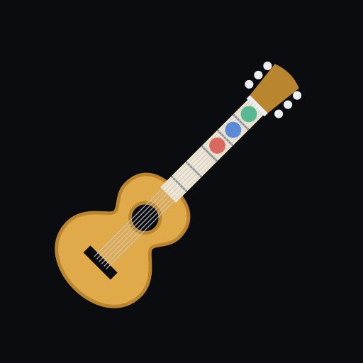

# Digital Harmonic Field — o que é o app

  

**O auxiliar do músico de igreja:** ensina harmonia de um jeito simples e serve
de ferramenta na hora do culto. Funciona no Android, **sem internet** e em
**modo escuro**.

Criado por **JR TECH** — José Renato, guitarrista e developer.

---

## Em poucas palavras

O Digital Harmonic Field reúne num só lugar o que o violonista ou guitarrista
de igreja precisa:

- **Saber os acordes de qualquer tom** e o papel de cada um (casa, preparação,
  tensão).
- **Tocar por cifra ou por número** (1, 4, 5, 6m…), como muita gente toca na
  igreja.
- **Descobrir o tom do hino** ouvindo a congregação pelo microfone.
- **Montar acordes no braço do violão** e sair do acorde "seco" para um som mais
  harmonioso.
- **Aprender passo a passo**, do zero, com lições e treinos.

---

## Para quem é

- **Iniciantes** que tocam violão ou guitarra na igreja e ainda estão
  aprendendo harmonia.
- Quem toca **"por grau"** e quer ver os acordes como 1, 4, 5, 6m.
- Músicos que acompanham **hinos da Harpa Cristã** (636 hinos) e precisam achar
  o tom rápido e saber para onde a música vai.
- Líderes de louvor e professores que ensinam os mais novos.

---

## Que problemas ele resolve

| Situação no culto | Como o app ajuda |
|---|---|
| "Em que tom está esse hino?" | **Detectar tom** ouve 5 s, depois mais 5 s… e mostra os 3 tons mais prováveis com os acordes para começar. |
| "Qual o próximo acorde?" | No **campo harmônico**, a cor de cada acorde mostra se ele é casa (verde), preparação (azul) ou tensão que pede volta (vermelho). |
| "O cantor pediu um tom mais baixo." | **Transposição** na hora (− / +) e **capotraste**, que diz em que casa colocar o capo. |
| "Eu toco por número." | A chave **Cifra \| Grau** muda o app inteiro para 1, 4, 5, 6m… |
| "Quero fazer umas graças entre os acordes." | **Passagens e enfeites** mostram, para cada momento do hino (voltar ao 1, descer o baixo, final do Amém…), as caídas e subidas que os tocadores experientes usam, com o som de antes e depois. |
| "Como faço esse acorde em outro lugar do braço?" | O **Dicionário de acordes** mostra as formas mais usadas e todas as formas, com o número do dedo em cada casa. |
| "Qual era o tom daquele hino?" | O **Repertório do culto** guarda os hinos do dia com o tom, o capotraste e uma observação. |
| "Meu acorde soa seco, de tiozão." | O **Harmonizar** do braço do violão sugere trocas como (9), 7M, sus4 → 5 e 6(9), com o som de antes e depois. |
| "Não sei onde ficam as notas no braço." | A aba **Notas** mostra todas as posições de uma nota, e a aba **Decorar** traz o método e jogos. |
| "Preciso ler os acordes de longe." | **Tela cheia** com acordes gigantes, o acorde da vez destacado e a tela sempre acesa. |

---

## O que tem dentro

O app tem quatro áreas na barra de baixo:

### 🎼 Campos
Os **24 tons** (12 maiores e 12 menores). Em cada um aparecem os 7 acordes,
a função de cada um, as notas que formam o acorde, a escala, os caminhos mais
comuns (como a **Progressão da Harpa**, 1 – 6m – 2m – 5 – 1) e a transposição.
Os tons favoritos ficam salvos. Deitando o celular, tudo cabe numa tela só.

### 🔁 Progressões
Sequências prontas no tom escolhido: **essenciais para hinos**, **finais de
frase** (como o do "Amém") e **louvor**. Cada uma abre em **tela cheia para
tocar**, com troca de tom na hora.

### 📚 Aprender
Um guia para quem está começando: o que é campo harmônico, as três funções,
como tirar música de ouvido, o sistema de números, o círculo das quintas com uso
prático e os módulos de graus:
- **Como pegar os graus**, com **treino pelo ouvido** (o app toca e você
  responde qual é o grau) e pela cifra.
- **Graus a fundo**: sétimas, dominantes secundárias, diminutos de passagem,
  baixo caminhando e empréstimos, tudo calculado no tom escolhido.

### 🧰 Ferramentas
- **Detectar tom**: ouve em rodadas de 5 s, com um modelo treinado com hinos no
  estilo da Harpa e ajuste de sensibilidade do microfone (*Culto forte*,
  *Normal*, *Capela baixa*). Sem evidência suficiente, **não chuta um tom**.
- **Braço do violão**: um braço realista para ver as notas, montar acordes
  automaticamente (com variações pelo braço), harmonizar hinos e decorar o
  braço com jogos.
- **Repertório do culto**: a lista de hinos do dia com o tom de cada um; abre o
  campo ou as passagens no tom certo.
- **Passagens e enfeites**: as "graças" entre os acordes, do básico ao
  profissional, com áudio e desenho no braço.
- **Dicionário de acordes**: as 5 formas mais usadas (CAGED) e todas as formas
  de cada acorde, com os dedos e o passo a passo.
- **Treino de graus**: pelo ouvido ou pela cifra, em níveis.
- **Metrônomo**, com marcar tempo (tap tempo) e compassos.
- **Capotraste**, que mostra em que casa colocar o capo para usar acordes
  abertos.

---

## Como é usar no dia a dia

1. **Antes do culto:** escolha o tom do hino em **Campos**, veja os acordes e
   abra a **Progressão** em tela cheia.
2. **Na hora:** se não souber o tom, abra **Detectar tom** enquanto a
   congregação canta. Em 5 a 15 segundos aparece o tom mais provável.
3. **Para enfeitar:** abra **Passagens e enfeites** no tom do hino e escolha
   uma caída para o fim da frase (ex.: 2m – 5 – 1).
4. **Para soar melhor:** no **Braço do violão → Harmonizar**, escolha uma ou
   duas trocas por estrofe (ex.: 1(9) e 5sus4 → 5).
5. **Em casa:** 10 minutos por dia em **Aprender**, **Treino de graus** e
   **Decorar**.

---

## Privacidade

- **Tudo funciona offline.** O app não tem conta, anúncios nem rastreamento.
- O microfone só é usado no **Detectar tom**. O áudio fica **apenas na
  memória** (os últimos 5 segundos) e é apagado ao sair da tela. **Nada é
  gravado nem enviado.**
- A única exceção é a **versão DEV** (de treino), instalada à parte, que grava
  trechos para melhorar o detector, e só quando o próprio autor a usa.

---

## Por dentro (para quem desenvolve)

| Item | Escolha |
|---|---|
| Plataforma | Android nativo (mínimo Android 7) |
| Linguagem / interface | Kotlin + Jetpack Compose + Material 3 |
| Áudio | `AudioRecord` / `AudioTrack` puros, sem bibliotecas externas |
| Detector de tom | Filtros de voz e baixo + rede neural pequena treinada (roda no aparelho) |
| Acordes no violão | Gerador próprio de formas, testado nota a nota |
| Testes | Robolectric + capturas de tela (Roborazzi) |

Mais detalhes:
- [`README.md`](../README.md): visão geral, como compilar e estrutura.
- [`docs/DESIGN.md`](DESIGN.md): o sistema visual (cores, fontes, componentes).
- [`docs/detector-de-tom.md`](detector-de-tom.md): como o detector funciona e o
  quanto ele acerta.
- [`docs/braco-do-violao.md`](braco-do-violao.md): o método de estudo do braço e
  as fontes.
- [`docs/treino-real.md`](treino-real.md): a versão DEV de treino.

---

## Apoie

O app é gratuito. Quem quiser ajudar a manter o projeto pode usar o botão
**Apoiar** na tela inicial.
